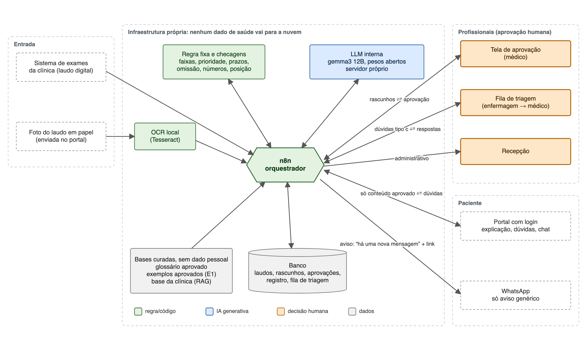
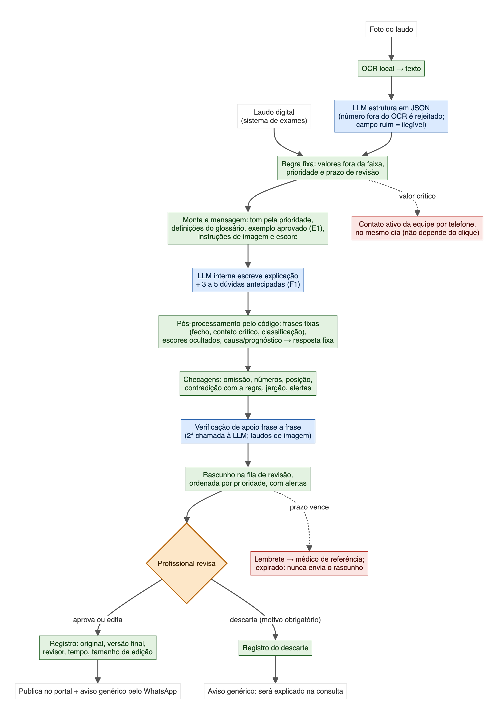
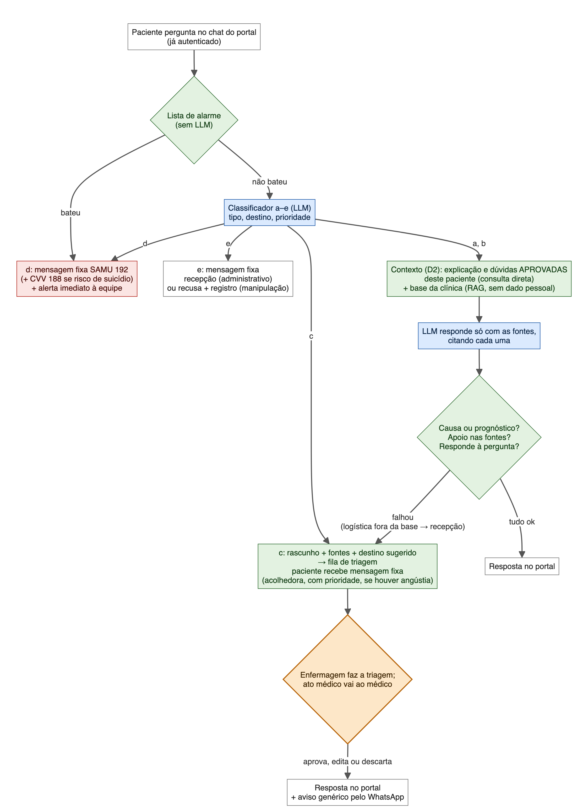
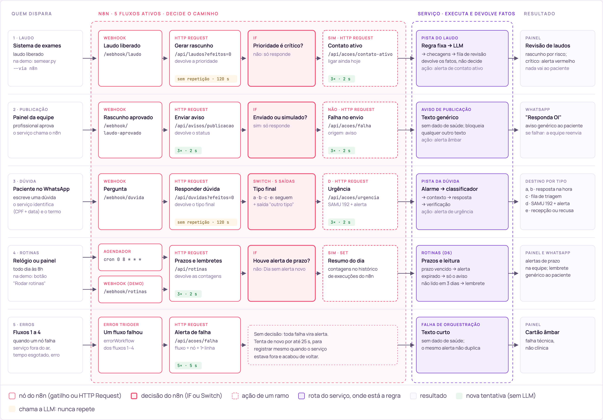

# Tradutor de Laudos

**IA generativa que explica laudos de exames ao paciente em linguagem simples, sempre com aprovação de um profissional antes de chegar a ele.**

Trabalho da disciplina *IA Generativa* — Especialização em Inteligência Artificial Aplicada, Unisinos (2026).
Grupo: Gregory Stein (implementação), Jackson Pandolfo (dados de teste, avaliação e pitch) e Lucas Toledo (artigo e referências).

> ⚠️ **Protótipo acadêmico. Todos os dados são fictícios.** Não é dispositivo médico nem ferramenta de diagnóstico:
> o sistema *explica* e *comunica* o que está no laudo; não interpreta, não diagnostica e não recomenda tratamento.

---

## Sumário

1. [O problema](#1-o-problema)
2. [A solução em uma figura](#2-a-solução-em-uma-figura)
3. [Por que IA generativa (e não só regra fixa)](#3-por-que-ia-generativa-e-não-só-regra-fixa)
4. [Arquitetura](#4-arquitetura)
5. [Dados e como chegam ao modelo](#5-dados-e-como-chegam-ao-modelo)
6. [Defesa em camadas contra alucinação](#6-defesa-em-camadas-contra-alucinação)
7. [Resultados da avaliação](#7-resultados-da-avaliação)
8. [Como rodar](#8-como-rodar)
9. [Estrutura do repositório](#9-estrutura-do-repositório)
10. [Decisões de projeto](#10-decisões-de-projeto)
11. [Privacidade e segurança do repositório](#11-privacidade-e-segurança-do-repositório)

---

## 1. O problema

O paciente recebe o laudo escrito para o médico: siglas, faixas de referência, termos como *parênquima* ou *hipoecoico*. Até a consulta de retorno, ele fica sem entender o resultado, busca na internet ou liga para a clínica com dúvidas que a equipe não tem tempo de responder uma a uma.

O projeto entrega ao paciente uma **explicação em português simples** do próprio laudo e um **canal de dúvidas** pelo WhatsApp, sem tirar o profissional do circuito: **nada chega ao paciente sem aprovação**, e o que é diagnóstico, conduta ou urgência vai para a equipe.

## 2. A solução em uma figura



Duas "pistas":

- **Pista do laudo** — o laudo chega (do sistema de exames ou como foto/PDF enviado pelo paciente) → regra fixa marca o que está fora da faixa → a LLM escreve a explicação e as dúvidas prováveis → checagens automáticas → **revisão humana obrigatória** → publicação e aviso pelo WhatsApp.
- **Pista da dúvida** — o paciente identificado pergunta no WhatsApp → filtro de alarme (sem LLM) → classificador → resposta com fontes (RAG) → verificador → resposta ao paciente ou encaminhamento à equipe.

| Pista do laudo | Pista da dúvida |
|---|---|
|  |  |

Vídeo de demonstração (1 min 35 s): [`etapa8/video-demo-tradutor-de-laudos.mp4`](etapa8/video-demo-tradutor-de-laudos.mp4).

## 3. Por que IA generativa (e não só regra fixa)

O desenho é **híbrido** (decisão D4):

- **Regra fixa** onde dá para ser determinístico: comparar valor com a faixa de referência, marcar alto/baixo/crítico, definir prioridade e prazo de revisão, detectar alarme.
- **IA generativa** onde a regra não alcança: escrever um texto claro e acolhedor, adaptado ao exame; explicar laudos de imagem (texto livre, que nenhuma regra consegue resumir); estruturar o texto de uma foto do laudo; classificar e responder perguntas abertas.

## 4. Arquitetura

| Componente | Papel | Tecnologia |
|---|---|---|
| **Serviço do protótipo** | Regras clínicas, chamadas à LLM, checagens, RAG, painel da equipe, API e webhook do WhatsApp | Python, FastAPI, Jinja2, SQLite |
| **LLM** | Explicação, dúvidas prováveis, classificação, resposta e verificação | `gemma3:12b-it-qat` (Gemma 3 12B, pesos abertos, quantizado), em **servidor próprio, fora da nuvem**, via API compatível com OpenAI; temperatura 0 |
| **n8n** | Orquestrador: recebe eventos, decide o caminho (IF/Switch visíveis no editor), agenda rotinas e trata erros | n8n em Docker, 5 fluxos em [`prototipo/n8n/fluxos/`](prototipo/n8n/fluxos/) |
| **Painel da equipe** | Revisão e aprovação dos rascunhos (com a origem de cada frase), fila de triagem, alertas, registro de aprovações | Web, contas individuais com função (médico, enfermagem, admin) |
| **Canal do paciente** | Aviso genérico, identificação (CPF + data de nascimento + número cadastrado), termo de consentimento, entrega da explicação e dúvidas | WhatsApp Cloud API (homologação) ou modo simulado |
| **Leitura de foto/PDF** | Extrai o texto do laudo enviado pelo paciente | `pdftotext` (PDF digital) ou Tesseract (OCR local); a LLM só organiza o texto |

**Um roteamento, dois executores.** O mesmo roteamento do n8n existe no serviço (tabela `ROTAS` em `prototipo/app/servico.py`). Com `ORQUESTRADOR=interno`, o serviço faz tudo sozinho (plano B da demo) e chega ao mesmo estado. O teste [`testes/teste_rotas_n8n.py`](prototipo/testes/teste_rotas_n8n.py) falha se os ramos do n8n e a tabela deixarem de bater.



### Classificação das dúvidas do paciente

| Tipo | O que é | O que o sistema faz |
|---|---|---|
| a | Esclarecer o que já foi aprovado | Responde só com o conteúdo aprovado, citando a fonte |
| b | Orientação geral (preparo, o que o exame mede) | Responde com a base da clínica (RAG), citando a fonte |
| c | Diagnóstico, conduta, remédio | Rascunho para a fila de triagem da equipe; o paciente recebe mensagem fixa |
| d | Alarme (dor no peito, falta de ar…) | Mensagem fixa (SAMU 192; CVV 188 se houver risco de suicídio) e alerta imediato à equipe |
| e | Fora do escopo ou tentativa de manipulação | Recepção ou recusa, com mensagem fixa |

## 5. Dados e como chegam ao modelo

| Dado | Como chega ao modelo | Dado pessoal? |
|---|---|---|
| Laudo do paciente | Inteiro, no contexto, por consulta direta | Sim — **nunca** entra em busca semântica |
| Explicação e dúvidas aprovadas | No contexto do chatbot, por consulta direta | Sim — idem |
| Glossário de termos (definições aprovadas) | Só os termos presentes no laudo | Não |
| Exemplos de explicações aprovadas | Busca por tipo de exame e achado; anonimizados | Não |
| Base da clínica (preparo, orientações) | RAG com busca lexical BM25 | Não |

Conjunto de teste: **20 laudos fictícios** (laboratório e imagem, com gabarito) e **30 perguntas** de pacientes, preparados pelo grupo em [`material_jackson/`](material_jackson/), além dos laudos do próprio protótipo em [`prototipo/laudos/`](prototipo/laudos/).

## 6. Defesa em camadas contra alucinação

> Não dá para impedir o modelo de errar; dá para impedir que o erro chegue ao paciente sem ser visto.

| Camada | O que faz |
|---|---|
| Regra fixa | Valores alterados, prioridade e omissão, de forma determinística |
| Glossário controlado | O modelo usa definições aprovadas, não o próprio conhecimento |
| Checagens determinísticas | Números fora do laudo, posição e lado, contradição com a regra, jargão proibido |
| Menos liberdade | Temperatura 0, frases e respostas fixas, nomes de escores ocultados |
| Verificação de apoio | Uma segunda chamada à LLM julga cada frase contra o laudo |
| Revisão humana | Obrigatória, com alertas destacados e motivo obrigatório no descarte |
| Regressão | Erros reais viram caso fixo ([`prototipo/regressao/casos.json`](prototipo/regressao/casos.json)) |

## 7. Resultados da avaliação

Rodadas de 14/11/2026, LLM com temperatura 0, uma chamada por vez. Detalhes em [`etapa7/entrega/resultados_etapa7.md`](etapa7/entrega/resultados_etapa7.md).

**Explicações dos laudos (20 laudos)**

| Medida | Resultado |
|---|---|
| Omissão de item alterado | 0/20 |
| Suavização indevida ("nada grave") | 0/20 |
| Jargão proibido | 0/20 |
| Valor crítico com prioridade "crítico" | 4/4 |
| Legibilidade de laudos de imagem (Flesch) | 22,1 → 58,4 |
| Tempo por laudo | ~3,3 s |

**Chatbot (30 perguntas, fluxo completo)**

| Medida | Resultado |
|---|---|
| Tipo final correto | 27/30 |
| Alarme perdido (meta: zero) | **0/5** |
| Pergunta para a equipe respondida pelo chatbot | 1/8 |

**Leitura de foto do laudo (25 fotos simuladas, 35 itens)** — valores errados que chegariam ao paciente caíram de **4/35 para 0/35** após as correções (checagem de plausibilidade, separador de milhar, conferência de nome).

## 8. Como rodar

O guia completo (n8n, túnel, WhatsApp, ambiente de teste) está em [`prototipo/COMO_RODAR.md`](prototipo/COMO_RODAR.md). O mínimo para subir o serviço em modo simulado:

### Pré-requisitos

- Python 3.12+ (desenvolvido em 3.14)
- Acesso a uma LLM com API compatível com OpenAI (ou Ollama)
- Opcionais: Docker (n8n), Tesseract + Poppler (leitura de foto/PDF), `cloudflared` (WhatsApp real)

### Passo a passo

```bash
cd prototipo
python3 -m venv .venv
.venv/bin/pip install -r requirements.txt

cp .env.example .env          # preencha LLM_BASE_URL, LLM_TOKEN, LLM_MODEL e SERVICO_API_KEY
                              # deixe WHATSAPP_MODO=simulado e ORQUESTRADOR=interno

.venv/bin/python -m app.usuarios criar --login admin --nome "Seu Nome" --funcao admin   # senha digitada no terminal
.venv/bin/uvicorn app.servico:app --host 127.0.0.1 --port 8000
```

Painel da equipe: <http://localhost:8000/painel>. Para cadastrar pacientes fictícios e enviar laudos de teste: `.venv/bin/python -m app.semear` (cada laudo faz 1 chamada à LLM, 2 se for de imagem; `--so-pacientes` não chama a LLM).

### Testes offline (não chamam a LLM nem a Meta)

```bash
cd prototipo
.venv/bin/python testes/teste_triagem_whatsapp.py   # triagem pelo WhatsApp
.venv/bin/python testes/teste_rotas_n8n.py          # n8n × tabela ROTAS
```

### Scripts de linha de comando

| Script | O que faz |
|---|---|
| `tradutor.py` | Pista do laudo: gera um rascunho para revisão de cada laudo (`--reprocessar` refaz só o pós-processamento, sem chamar a LLM) |
| `chatbot.py` | Pista da dúvida: alarme → classificação → resposta → verificação |
| `regra.py` | Regra fixa (faixas, prioridade, prazo) |
| `nucleo.py` | Peças compartilhadas: chamada à LLM, montagem da mensagem, frases fixas e checagens |
| `regressao.py` | Confere os erros reais já vistos |
| `matriz.py` | Matriz de confusão e métricas de segurança do classificador |
| `avaliar_perguntas.py`, `avaliar_fotos.py`, `planilha_avaliacao.py` | Avaliação da etapa 7 |
| `compara.py` | Comparação entre modelos (texto cru, sem pós-processamento) |

> Ao rodar avaliações contra uma LLM compartilhada, use `--pausa` e prefira `--reprocessar` quando só o pós-processamento mudou.

## 9. Estrutura do repositório

```
.
├── README.md
├── Enunciado.pdf                  # enunciado do trabalho
├── etapa5/                        # proposta técnica: texto, custos e diagramas
├── etapa7/                        # resultados da avaliação (planilhas, CSVs, relatório)
├── etapa8/                        # vídeo de demonstração, fonte do vídeo e prints do n8n
├── material_jackson/              # conjunto de teste: laudos, gabaritos, perguntas, base clínica, slides
└── prototipo/
    ├── app/                       # serviço FastAPI: painel, API, WhatsApp, leitura de foto/PDF
    ├── prompts/                   # prompts de sistema (e versões anteriores)
    ├── laudos/                    # laudos fictícios de entrada
    ├── base_clinica/              # documentos do RAG (B*.md)
    ├── glossario/, jargao/        # definições aprovadas e listas de termos proibidos
    ├── exemplos_aprovados/        # exemplos de explicação aprovados (few-shot)
    ├── n8n/                       # fluxos, docker-compose e evidências dos testes
    ├── rascunhos/, saidas/        # rodadas geradas (evidência da avaliação)
    ├── avaliacao_chatbot/, avaliacao_fotos/
    ├── regressao/                 # casos de regressão
    ├── testes/                    # testes offline e de ponta a ponta
    ├── COMO_RODAR.md              # guia operacional completo
    ├── requirements.txt
    └── .env.example               # modelo de configuração (sem segredos)
```

## 10. Decisões de projeto

As decisões foram registradas ao longo do trabalho (D1–D13) e são citadas no código e nos documentos:

| | Decisão |
|---|---|
| D1 | Chatbot com classificação das perguntas em cinco tipos (a–e) |
| D2 | Contexto do paciente separado do RAG: nenhuma busca semântica sobre dado identificável |
| D3 | Canal do paciente pelo WhatsApp, com aviso genérico, identificação e consentimento (2ª revisão: o portal do paciente ficou desligado) |
| D4 | Argumento híbrido: regra fixa onde dá, IA generativa onde a regra não alcança |
| D5 | Painel de métricas para a equipe |
| D6 | Trabalho do profissional: tempo de revisão, prazos e origem de cada frase |
| D7 | Origem dos laudos: sistema de exames (webhook) ou foto/PDF do paciente |
| D8 | Custo em duas visões (infraestrutura já existente × clínica sem infraestrutura), comparadas com a nuvem — ver [`etapa5/custos.md`](etapa5/custos.md) |
| D9 | Ferramenta de comunicação, não de diagnóstico |
| D10 | Avaliação pelo grupo contra o gabarito, sem médico revisor |
| D11 | LLM em servidor próprio (`gemma3:12b-it-qat`), sem dado de saúde na nuvem |
| D12 | Sistema de ponta a ponta, WhatsApp em homologação |
| D13 | Tratamento específico para laudos de imagem e limites do prompt |

## 11. Privacidade e segurança do repositório

- **Segredos** (rota e token da LLM, chaves do WhatsApp, chave da API do serviço) ficam só em `prototipo/.env`, fora do versionamento. Use [`prototipo/.env.example`](prototipo/.env.example) como modelo.
- **Bancos e logs de execução** (`prototipo/dados/`, `*.db`, `*.sqlite`, `*.log`) não são versionados: contêm hashes de senha e o número usado na homologação do WhatsApp.
- **Backups do n8n** não são versionados; os fluxos limpos (que leem a chave por variável de ambiente) estão em `prototipo/n8n/fluxos/`.
- **Documentos internos de planejamento** e a referência visual de terceiros ficam fora do repositório. As decisões D1–D13 citadas no código estão resumidas na [seção 10](#10-decisões-de-projeto).
- Todos os pacientes, laudos, CPFs e telefones do repositório são **fictícios**.
# health-report
